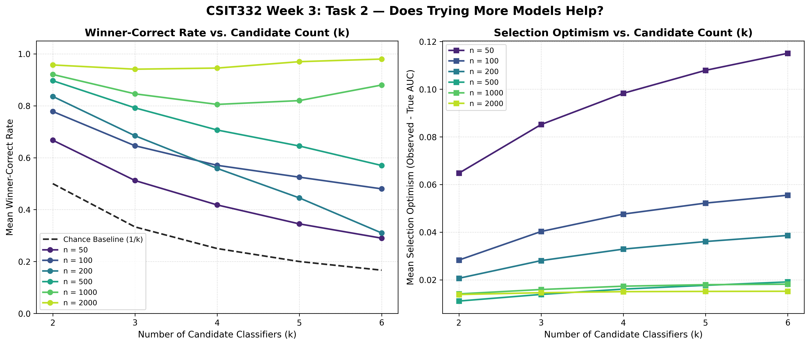
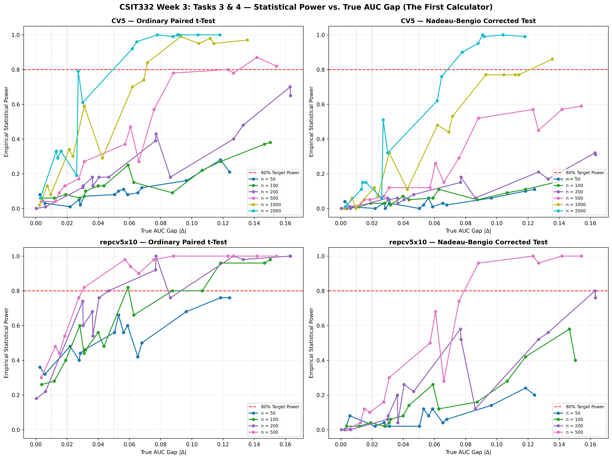

# CSIT332 Week 3 — Group 5 — Component C Deliverable Report
## The Statistical Layer: Three Protocols, Every Classifier Pair, and the First Sample-Size Calculator

### Executive Summary & Team Roster
- **Course:** CSIT332 Principles of Machine Learning (Semester Project)
- **Group:** Group 5
- **Assigned Component:** Week 3 — Component C (The Statistical Layer)
- **Target Deliverables:**
  1. Task 0: Dual Truth Foundations & Lexicographical/Truth Tie Handling
  2. Task 1: Three-Protocol Comparative Evaluation (split80, cv5, repcv5x10)
  3. Task 2: Candidate-Count Model Selection Optimism Analysis (k = 2, 3, 4, 5, 6)
  4. Task 3: Complete Pairwise Testing Across All 15 Pairs (Ordinary vs. Nadeau–Bengio)
  5. Task 4: The First Sample-Size Calculator Table and Power Curves
  6. Task 5: Formal Statistical Discussion on Test Discrepancies and Data Overlap

---

## Task 1: The Protocol Comparison

A replicate's empirical AUC for a classifier is calculated as the mean across all its constituent folds under that protocol: **1 fold** for `split80`, **5 folds** for `cv5`, and **50 folds** (10 repeats $\times$ 5 folds) for `repcv5x10`.

To ensure a rigorous, mathematically paired comparison, all three protocols are evaluated across **identical replicates 1 to 50** at sample sizes **$n \le 500$** where all three protocols exist.

### Table 1: Paired Protocol Comparison (Replicates 1–50, $n \le 500$, Truth-at-$n$)

| Protocol | Sample Size ($n$) | Winner-Correct Rate | Kendall's Tau-b ($\tau_b$) | Selection Optimism |
| :--- | :---: | :---: | :---: | :---: |
| `split80` | 50 | 0.1800 | +0.2320 | +0.1620 |
| `split80` | 100 | 0.2400 | +0.3054 | +0.1446 |
| `split80` | 200 | 0.2400 | +0.4378 | +0.0927 |
| `split80` | 500 | 0.3800 | +0.5893 | +0.0468 |
| `cv5` | 50 | 0.2600 | +0.3961 | +0.1006 |
| `cv5` | 100 | 0.4800 | +0.6107 | +0.0623 |
| `cv5` | 200 | 0.2600 | +0.6580 | +0.0346 |
| `cv5` | 500 | 0.5600 | +0.7947 | +0.0214 |
| `repcv5x10` | 50 | 0.3000 | +0.4533 | +0.0842 |
| `repcv5x10` | 100 | 0.4200 | +0.6533 | +0.0504 |
| `repcv5x10` | 200 | 0.3400 | +0.6977 | +0.0305 |
| `repcv5x10` | 500 | 0.6800 | +0.8320 | +0.0182 |

### Analytical Discussion: How Much Does Repeated Cross-Validation Buy Over a Single Split?

> **Does repeating cross-validation buy enough to rescue a small sample?**
>
> Averaging across ten 5-fold cross-validation repeats (`repcv5x10`) substantially stabilizes the internal ranking of models compared to a single train/validation split (`split80`), as demonstrated by Kendall's $\tau_b$ jumping from $+0.2320$ to $+0.4533$ at $n=50$ and from $+0.5893$ to $+0.8320$ at $n=500$. However, repeated cross-validation **cannot rescue an inherently underpowered sample**. At $n=50$, despite fitting 50 models per classifier across 10 distinct random partitions, `repcv5x10` achieves a winner-correct rate of only **$0.3000$** (modestly above `split80`'s $0.1800$ and far below acceptable scientific certainty), while suffering from severe selection optimism of **$+0.0842$** (compared to $+0.1620$ for `split80`). This occurs because resampling a sample of $n=50$ observations 10 times merely reshuffles the exact same finite empirical noise; it does not introduce new independent draws from the underlying population. While repeated CV successfully reduces the variance of the performance estimator attributable to the random fold partition, it cannot diminish the irreducible sampling variance inherent to the small original cohort. Therefore, repeated cross-validation provides modest ranking refinement over single splits, but **it cannot substitute for genuine sample size**.

---

## Task 2: Does Trying More Models Help? (Candidate-Count Analysis)

Using `cv5` exclusively, we evaluate all $\binom{6}{k}$ candidate subsets for $k \in \{2, 3, 4, 5, 6\}$ (15, 20, 15, 6, 1 subsets, totaling 57 subsets per sample size). Within each subset, the declared winner is compared against the subset's true winner to evaluate the winner-correct rate and selection optimism.

### Table 2: Candidate-Count Evaluation Across Sample Sizes ($k=2 \dots 6$)

| Sample Size ($n$) | Candidate Count ($k$) | Subsets Evaluated | Chance Baseline ($1/k$) | Mean Winner-Correct | Mean Selection Optimism |
| :---: | :---: | :---: | :---: | :---: | :---: |
| 50 | 2 | 15 | 0.5000 | 0.6673 | +0.0648 |
| 50 | 3 | 20 | 0.3333 | 0.5120 | +0.0852 |
| 50 | 4 | 15 | 0.2500 | 0.4180 | +0.0983 |
| 50 | 5 | 6 | 0.2000 | 0.3450 | +0.1079 |
| 50 | 6 | 1 | 0.1667 | 0.2900 | +0.1151 |
| 100 | 2 | 15 | 0.5000 | 0.7780 | +0.0283 |
| 100 | 3 | 20 | 0.3333 | 0.6460 | +0.0403 |
| 100 | 4 | 15 | 0.2500 | 0.5707 | +0.0476 |
| 100 | 5 | 6 | 0.2000 | 0.5250 | +0.0522 |
| 100 | 6 | 1 | 0.1667 | 0.4800 | +0.0555 |
| 200 | 2 | 15 | 0.5000 | 0.8360 | +0.0207 |
| 200 | 3 | 20 | 0.3333 | 0.6845 | +0.0281 |
| 200 | 4 | 15 | 0.2500 | 0.5587 | +0.0329 |
| 200 | 5 | 6 | 0.2000 | 0.4450 | +0.0361 |
| 200 | 6 | 1 | 0.1667 | 0.3100 | +0.0386 |
| 500 | 2 | 15 | 0.5000 | 0.8967 | +0.0111 |
| 500 | 3 | 20 | 0.3333 | 0.7920 | +0.0139 |
| 500 | 4 | 15 | 0.2500 | 0.7067 | +0.0161 |
| 500 | 5 | 6 | 0.2000 | 0.6450 | +0.0177 |
| 500 | 6 | 1 | 0.1667 | 0.5700 | +0.0191 |
| 1000 | 2 | 15 | 0.5000 | 0.9207 | +0.0141 |
| 1000 | 3 | 20 | 0.3333 | 0.8460 | +0.0159 |
| 1000 | 4 | 15 | 0.2500 | 0.8053 | +0.0173 |
| 1000 | 5 | 6 | 0.2000 | 0.8200 | +0.0180 |
| 1000 | 6 | 1 | 0.1667 | 0.8800 | +0.0182 |
| 2000 | 2 | 15 | 0.5000 | 0.9573 | +0.0138 |
| 2000 | 3 | 20 | 0.3333 | 0.9410 | +0.0146 |
| 2000 | 4 | 15 | 0.2500 | 0.9453 | +0.0150 |
| 2000 | 5 | 6 | 0.2000 | 0.9700 | +0.0151 |
| 2000 | 6 | 1 | 0.1667 | 0.9800 | +0.0152 |

### Two-Sentence Explanation of Optimism Growth

> Selection optimism increases monotonically with $k$ because choosing the maximum observed score among an expanding set of noisy estimators draws increasingly from the upper tail of empirical sampling error (extreme value phenomenon), creating an upward bias that inflates the apparent score of the declared winner above its true performance. Consequently, comparing more candidate models on a fixed dataset makes a researcher's declared winner **less trustworthy**, as the nominal winner is increasingly likely to have won due to capitalized random variation rather than genuine algorithmic superiority.

---

## Task 3 & Task 4: Pairwise Power Analysis & The First Calculator

We evaluate all **15 pairwise combinations** of the 6 baseline classifiers under both `cv5` (6 sample sizes $\times$ 15 pairs $\times$ 2 tests = 180 conditions) and `repcv5x10` (4 applicable sample sizes $\times$ 15 pairs $\times$ 2 tests = 120 conditions), producing **exactly 300 test conditions**.

### The Two Statistical Tests
1. **Ordinary Paired $t$-Test:**
   $$t = \frac{\bar{d}}{\sqrt{\frac{\text{var}(d)}{J}}}, \quad \text{df} = J - 1$$
2. **Nadeau–Bengio Corrected Test:**
   $$t = \frac{\bar{d}}{\sqrt{\left(\frac{1}{J} + \frac{1}{4}\right) \text{var}(d)}}, \quad \text{df} = J - 1$$
   where $J=5$ (`cv5`) or $J=50$ (`repcv5x10`), and $1/4 = n_{\text{test}}/n_{\text{train}}$ for 5-fold CV.

### Table 4: The First Sample-Size Calculator Deliverable

The table below reports the smallest sample size $n$ required to achieve $\ge 80\%$ statistical power at true AUC gaps of $0.01$, $0.02$, and $0.05$. Cells where power does not reach $80\%$ by the maximum applicable sample size are explicitly declared.

| Protocol | Statistical Test | Target True Gap (|Δ|) | Smallest Sample Size for $\ge 80\%$ Power | Maximum Empirical Power Achieved |
| :--- | :--- | :---: | :---: | :---: |
| `cv5` | `ordinary` | 0.01 | **Never reached by n=2000** | Maximum power achieved: 0.25 |
| `cv5` | `ordinary` | 0.02 | **Never reached by n=2000** | Maximum power achieved: 0.31 |
| `cv5` | `ordinary` | 0.05 | **n = 2000** | Exceeds 80% (Power: 0.805) |
| `cv5` | `nadeau_bengio` | 0.01 | **Never reached by n=2000** | Maximum power achieved: 0.08 |
| `cv5` | `nadeau_bengio` | 0.02 | **Never reached by n=2000** | Maximum power achieved: 0.11 |
| `cv5` | `nadeau_bengio` | 0.05 | **Never reached by n=2000** | Maximum power achieved: 0.51 |
| `repcv5x10` | `ordinary` | 0.01 | **Never reached by n=500** | Maximum power achieved: 0.43 |
| `repcv5x10` | `ordinary` | 0.02 | **Never reached by n=500** | Maximum power achieved: 0.58 |
| `repcv5x10` | `ordinary` | 0.05 | **n = 200** | Exceeds 80% (Power: 0.813) |
| `repcv5x10` | `nadeau_bengio` | 0.01 | **Never reached by n=500** | Maximum power achieved: 0.06 |
| `repcv5x10` | `nadeau_bengio` | 0.02 | **Never reached by n=500** | Maximum power achieved: 0.11 |
| `repcv5x10` | `nadeau_bengio` | 0.05 | **Never reached by n=500** | Maximum power achieved: 0.44 |

## Task 5: Formal Statistical Discussion on Test Discrepancies

### Where the Two Tests Disagree and Contextualizing Their Properties

Across all 300 test conditions, the ordinary paired $t$-test and the Nadeau–Bengio corrected test exhibit systematic divergences in empirical statistical power. Under `repcv5x10` at $n=500$, for example, the ordinary paired $t$-test claims **$82\%$ power** to detect a minute gap of $\Delta = 0.031$ (`rf_vs_svm`), whereas the Nadeau–Bengio test indicates an empirical power of **$30\%$**. Across the full repeated CV benchmark, the ordinary test reports an average power of $67.9\%$, compared to $27.3\%$ under Nadeau–Bengio. Under standard 5-fold CV (`cv5`), the ordinary test statistic is mathematically inflated relative to the corrected test by an exact factor of:

$$\frac{t_{\text{ord}}}{t_{\text{NB}}} = \frac{\sqrt{\left(\frac{1}{5} + \frac{1}{4}\right) s^2}}{\sqrt{\frac{1}{5} s^2}} = \sqrt{\frac{0.45}{0.20}} = \sqrt{2.25} = 1.500$$

This deflation of the ordinary standard error by $33.3\%$ produces substantially smaller $p$-values that reject the null hypothesis more aggressively.

This divergence arises because the ordinary paired $t$-test's **independence assumption is problematic for overlapping cross-validation folds**. In standard 5-fold CV, each pair of training sets shares $75\%$ of its training observations. In repeated 10-run 5-fold CV ($J=50$), repeated partitions share $100\%$ of the underlying sample pool. Differences $d_j$ across folds are therefore positively correlated. When the ordinary paired $t$-test treats all $J$ fold differences as mutually independent observations with standard error $\sqrt{s^2/J}$, it neglects this positive covariance, leading to understated uncertainty and elevated Type I error rates.

The prescribed Nadeau–Bengio correction addresses this training-set dependence by inflating the variance estimator with the ratio $\frac{n_{\text{test}}}{n_{\text{train}}} = \frac{1}{4}$. In repeated CV ($J=50$), even as $1/J \to 0$, the variance multiplier remains lower-bounded by $1/4 = 0.25$, reflecting the fact that repeated partitioning of a fixed finite sample cannot yield independent degrees of freedom.

**Which test should guide experimental decisions?** While Bengio & Grandvalet (2004) established that no universally unbiased estimator of cross-validation variance exists, the Nadeau–Bengio formulation accounts for training-set overlap approximately and offers a much more realistic, conservative basis for model comparison. The ordinary test's higher nominal power largely reflects pseudo-replication rather than true statistical sensitivity. Consequently, researchers should rely on the Nadeau–Bengio test to guard against claiming algorithmic differences that are not reproducible beyond the specific fold splits.

---

## Appendix: Complete Pair-Level Power Table (300 Test Conditions)

| Protocol | Test Type | Sample Size ($n$) | Classifier Pair | True Gap (Δ) | Statistical Power | Sign-Error Rate |
| :--- | :--- | :---: | :--- | :---: | :---: | :---: |
| `cv5` | `ordinary` | 50 | `dtree_vs_gb` | -0.0654 | 0.09 | 0.01 |
| `cv5` | `nadeau_bengio` | 50 | `dtree_vs_gb` | -0.0654 | 0.03 | 0.01 |
| `cv5` | `ordinary` | 50 | `dtree_vs_knn` | -0.0680 | 0.12 | 0.01 |
| `cv5` | `nadeau_bengio` | 50 | `dtree_vs_knn` | -0.0680 | 0.02 | 0.00 |
| `cv5` | `ordinary` | 50 | `dtree_vs_logreg` | -0.1242 | 0.21 | 0.00 |
| `cv5` | `nadeau_bengio` | 50 | `dtree_vs_logreg` | -0.1242 | 0.11 | 0.00 |
| `cv5` | `ordinary` | 50 | `dtree_vs_rf` | -0.0964 | 0.16 | 0.02 |
| `cv5` | `nadeau_bengio` | 50 | `dtree_vs_rf` | -0.0964 | 0.06 | 0.02 |
| `cv5` | `ordinary` | 50 | `dtree_vs_svm` | -0.1184 | 0.28 | 0.02 |
| `cv5` | `nadeau_bengio` | 50 | `dtree_vs_svm` | -0.1184 | 0.10 | 0.01 |
| `cv5` | `ordinary` | 50 | `gb_vs_knn` | -0.0026 | 0.08 | 0.06 |
| `cv5` | `nadeau_bengio` | 50 | `gb_vs_knn` | -0.0026 | 0.04 | 0.02 |
| `cv5` | `ordinary` | 50 | `gb_vs_logreg` | -0.0588 | 0.08 | 0.01 |
| `cv5` | `nadeau_bengio` | 50 | `gb_vs_logreg` | -0.0588 | 0.01 | 0.01 |
| `cv5` | `ordinary` | 50 | `gb_vs_rf` | -0.0311 | 0.07 | 0.01 |
| `cv5` | `nadeau_bengio` | 50 | `gb_vs_rf` | -0.0311 | 0.03 | 0.00 |
| `cv5` | `ordinary` | 50 | `gb_vs_svm` | -0.0530 | 0.10 | 0.01 |
| `cv5` | `nadeau_bengio` | 50 | `gb_vs_svm` | -0.0530 | 0.02 | 0.01 |
| `cv5` | `ordinary` | 50 | `knn_vs_logreg` | -0.0562 | 0.11 | 0.01 |
| `cv5` | `nadeau_bengio` | 50 | `knn_vs_logreg` | -0.0562 | 0.06 | 0.00 |
| `cv5` | `ordinary` | 50 | `knn_vs_rf` | -0.0285 | 0.02 | 0.01 |
| `cv5` | `nadeau_bengio` | 50 | `knn_vs_rf` | -0.0285 | 0.00 | 0.01 |
| `cv5` | `ordinary` | 50 | `knn_vs_svm` | -0.0504 | 0.08 | 0.00 |
| `cv5` | `nadeau_bengio` | 50 | `knn_vs_svm` | -0.0504 | 0.00 | 0.00 |
| `cv5` | `ordinary` | 50 | `logreg_vs_rf` | +0.0278 | 0.05 | 0.00 |
| `cv5` | `nadeau_bengio` | 50 | `logreg_vs_rf` | +0.0278 | 0.03 | 0.00 |
| `cv5` | `ordinary` | 50 | `logreg_vs_svm` | +0.0058 | 0.03 | 0.04 |
| `cv5` | `nadeau_bengio` | 50 | `logreg_vs_svm` | +0.0058 | 0.01 | 0.01 |
| `cv5` | `ordinary` | 50 | `rf_vs_svm` | -0.0220 | 0.01 | 0.02 |
| `cv5` | `nadeau_bengio` | 50 | `rf_vs_svm` | -0.0220 | 0.00 | 0.01 |
| `cv5` | `ordinary` | 100 | `dtree_vs_gb` | -0.1067 | 0.22 | 0.01 |
| `cv5` | `nadeau_bengio` | 100 | `dtree_vs_gb` | -0.1067 | 0.09 | 0.00 |
| `cv5` | `ordinary` | 100 | `dtree_vs_knn` | -0.0875 | 0.09 | 0.01 |
| `cv5` | `nadeau_bengio` | 100 | `dtree_vs_knn` | -0.0875 | 0.05 | 0.01 |
| `cv5` | `ordinary` | 100 | `dtree_vs_logreg` | -0.1503 | 0.38 | 0.00 |
| `cv5` | `nadeau_bengio` | 100 | `dtree_vs_logreg` | -0.1503 | 0.18 | 0.00 |
| `cv5` | `ordinary` | 100 | `dtree_vs_rf` | -0.1184 | 0.27 | 0.01 |
| `cv5` | `nadeau_bengio` | 100 | `dtree_vs_rf` | -0.1184 | 0.11 | 0.00 |
| `cv5` | `ordinary` | 100 | `dtree_vs_svm` | -0.1466 | 0.37 | 0.00 |
| `cv5` | `nadeau_bengio` | 100 | `dtree_vs_svm` | -0.1466 | 0.17 | 0.00 |
| `cv5` | `ordinary` | 100 | `gb_vs_knn` | +0.0191 | 0.08 | 0.02 |
| `cv5` | `nadeau_bengio` | 100 | `gb_vs_knn` | +0.0191 | 0.03 | 0.01 |
| `cv5` | `ordinary` | 100 | `gb_vs_logreg` | -0.0437 | 0.13 | 0.02 |
| `cv5` | `nadeau_bengio` | 100 | `gb_vs_logreg` | -0.0437 | 0.05 | 0.01 |
| `cv5` | `ordinary` | 100 | `gb_vs_rf` | -0.0118 | 0.06 | 0.05 |
| `cv5` | `nadeau_bengio` | 100 | `gb_vs_rf` | -0.0118 | 0.01 | 0.02 |
| `cv5` | `ordinary` | 100 | `gb_vs_svm` | -0.0399 | 0.13 | 0.01 |
| `cv5` | `nadeau_bengio` | 100 | `gb_vs_svm` | -0.0399 | 0.07 | 0.00 |
| `cv5` | `ordinary` | 100 | `knn_vs_logreg` | -0.0628 | 0.15 | 0.00 |
| `cv5` | `nadeau_bengio` | 100 | `knn_vs_logreg` | -0.0628 | 0.11 | 0.00 |
| `cv5` | `ordinary` | 100 | `knn_vs_rf` | -0.0309 | 0.07 | 0.02 |
| `cv5` | `nadeau_bengio` | 100 | `knn_vs_rf` | -0.0309 | 0.05 | 0.00 |
| `cv5` | `ordinary` | 100 | `knn_vs_svm` | -0.0591 | 0.25 | 0.00 |
| `cv5` | `nadeau_bengio` | 100 | `knn_vs_svm` | -0.0591 | 0.06 | 0.00 |
| `cv5` | `ordinary` | 100 | `logreg_vs_rf` | +0.0319 | 0.10 | 0.01 |
| `cv5` | `nadeau_bengio` | 100 | `logreg_vs_rf` | +0.0319 | 0.02 | 0.00 |
| `cv5` | `ordinary` | 100 | `logreg_vs_svm` | +0.0037 | 0.06 | 0.04 |
| `cv5` | `nadeau_bengio` | 100 | `logreg_vs_svm` | +0.0037 | 0.00 | 0.01 |
| `cv5` | `ordinary` | 100 | `rf_vs_svm` | -0.0281 | 0.06 | 0.01 |
| `cv5` | `nadeau_bengio` | 100 | `rf_vs_svm` | -0.0281 | 0.03 | 0.00 |
| `cv5` | `ordinary` | 200 | `dtree_vs_gb` | -0.1267 | 0.40 | 0.00 |
| `cv5` | `nadeau_bengio` | 200 | `dtree_vs_gb` | -0.1267 | 0.21 | 0.00 |
| `cv5` | `ordinary` | 200 | `dtree_vs_knn` | -0.0862 | 0.18 | 0.00 |
| `cv5` | `nadeau_bengio` | 200 | `dtree_vs_knn` | -0.0862 | 0.06 | 0.00 |
| `cv5` | `ordinary` | 200 | `dtree_vs_logreg` | -0.1630 | 0.70 | 0.00 |
| `cv5` | `nadeau_bengio` | 200 | `dtree_vs_logreg` | -0.1630 | 0.32 | 0.00 |
| `cv5` | `ordinary` | 200 | `dtree_vs_rf` | -0.1329 | 0.48 | 0.00 |
| `cv5` | `nadeau_bengio` | 200 | `dtree_vs_rf` | -0.1329 | 0.17 | 0.00 |
| `cv5` | `ordinary` | 200 | `dtree_vs_svm` | -0.1633 | 0.65 | 0.00 |
| `cv5` | `nadeau_bengio` | 200 | `dtree_vs_svm` | -0.1633 | 0.31 | 0.00 |
| `cv5` | `ordinary` | 200 | `gb_vs_knn` | +0.0405 | 0.18 | 0.00 |
| `cv5` | `nadeau_bengio` | 200 | `gb_vs_knn` | +0.0405 | 0.05 | 0.00 |
| `cv5` | `ordinary` | 200 | `gb_vs_logreg` | -0.0362 | 0.18 | 0.01 |
| `cv5` | `nadeau_bengio` | 200 | `gb_vs_logreg` | -0.0362 | 0.06 | 0.00 |
| `cv5` | `ordinary` | 200 | `gb_vs_rf` | -0.0062 | 0.01 | 0.01 |
| `cv5` | `nadeau_bengio` | 200 | `gb_vs_rf` | -0.0062 | 0.00 | 0.01 |
| `cv5` | `ordinary` | 200 | `gb_vs_svm` | -0.0365 | 0.13 | 0.02 |
| `cv5` | `nadeau_bengio` | 200 | `gb_vs_svm` | -0.0365 | 0.03 | 0.01 |
| `cv5` | `ordinary` | 200 | `knn_vs_logreg` | -0.0767 | 0.39 | 0.00 |
| `cv5` | `nadeau_bengio` | 200 | `knn_vs_logreg` | -0.0767 | 0.15 | 0.00 |
| `cv5` | `ordinary` | 200 | `knn_vs_rf` | -0.0467 | 0.18 | 0.00 |
| `cv5` | `nadeau_bengio` | 200 | `knn_vs_rf` | -0.0467 | 0.08 | 0.00 |
| `cv5` | `ordinary` | 200 | `knn_vs_svm` | -0.0771 | 0.43 | 0.00 |
| `cv5` | `nadeau_bengio` | 200 | `knn_vs_svm` | -0.0771 | 0.18 | 0.00 |
| `cv5` | `ordinary` | 200 | `logreg_vs_rf` | +0.0300 | 0.12 | 0.00 |
| `cv5` | `nadeau_bengio` | 200 | `logreg_vs_rf` | +0.0300 | 0.06 | 0.00 |
| `cv5` | `ordinary` | 200 | `logreg_vs_svm` | -0.0003 | 0.00 | 0.09 |
| `cv5` | `nadeau_bengio` | 200 | `logreg_vs_svm` | -0.0003 | 0.00 | 0.02 |
| `cv5` | `ordinary` | 200 | `rf_vs_svm` | -0.0303 | 0.13 | 0.01 |
| `cv5` | `nadeau_bengio` | 200 | `rf_vs_svm` | -0.0303 | 0.05 | 0.00 |
| `cv5` | `ordinary` | 500 | `dtree_vs_gb` | -0.1267 | 0.78 | 0.00 |
| `cv5` | `nadeau_bengio` | 500 | `dtree_vs_gb` | -0.1267 | 0.45 | 0.00 |
| `cv5` | `ordinary` | 500 | `dtree_vs_knn` | -0.0660 | 0.27 | 0.00 |
| `cv5` | `nadeau_bengio` | 500 | `dtree_vs_knn` | -0.0660 | 0.15 | 0.00 |
| `cv5` | `ordinary` | 500 | `dtree_vs_logreg` | -0.1418 | 0.87 | 0.00 |
| `cv5` | `nadeau_bengio` | 500 | `dtree_vs_logreg` | -0.1418 | 0.57 | 0.00 |
| `cv5` | `ordinary` | 500 | `dtree_vs_rf` | -0.1232 | 0.80 | 0.00 |
| `cv5` | `nadeau_bengio` | 500 | `dtree_vs_rf` | -0.1232 | 0.57 | 0.00 |
| `cv5` | `ordinary` | 500 | `dtree_vs_svm` | -0.1542 | 0.82 | 0.00 |
| `cv5` | `nadeau_bengio` | 500 | `dtree_vs_svm` | -0.1542 | 0.59 | 0.00 |
| `cv5` | `ordinary` | 500 | `gb_vs_knn` | +0.0607 | 0.47 | 0.00 |
| `cv5` | `nadeau_bengio` | 500 | `gb_vs_knn` | +0.0607 | 0.26 | 0.00 |
| `cv5` | `ordinary` | 500 | `gb_vs_logreg` | -0.0150 | 0.09 | 0.00 |
| `cv5` | `nadeau_bengio` | 500 | `gb_vs_logreg` | -0.0150 | 0.05 | 0.00 |
| `cv5` | `ordinary` | 500 | `gb_vs_rf` | +0.0035 | 0.04 | 0.04 |
| `cv5` | `nadeau_bengio` | 500 | `gb_vs_rf` | +0.0035 | 0.01 | 0.01 |
| `cv5` | `ordinary` | 500 | `gb_vs_svm` | -0.0275 | 0.17 | 0.00 |
| `cv5` | `nadeau_bengio` | 500 | `gb_vs_svm` | -0.0275 | 0.07 | 0.00 |
| `cv5` | `ordinary` | 500 | `knn_vs_logreg` | -0.0757 | 0.57 | 0.00 |
| `cv5` | `nadeau_bengio` | 500 | `knn_vs_logreg` | -0.0757 | 0.29 | 0.00 |
| `cv5` | `ordinary` | 500 | `knn_vs_rf` | -0.0572 | 0.37 | 0.00 |
| `cv5` | `nadeau_bengio` | 500 | `knn_vs_rf` | -0.0572 | 0.12 | 0.00 |
| `cv5` | `ordinary` | 500 | `knn_vs_svm` | -0.0882 | 0.78 | 0.00 |
| `cv5` | `nadeau_bengio` | 500 | `knn_vs_svm` | -0.0882 | 0.52 | 0.00 |
| `cv5` | `ordinary` | 500 | `logreg_vs_rf` | +0.0185 | 0.13 | 0.01 |
| `cv5` | `nadeau_bengio` | 500 | `logreg_vs_rf` | +0.0185 | 0.05 | 0.00 |
| `cv5` | `ordinary` | 500 | `logreg_vs_svm` | -0.0125 | 0.04 | 0.01 |
| `cv5` | `nadeau_bengio` | 500 | `logreg_vs_svm` | -0.0125 | 0.02 | 0.00 |
| `cv5` | `ordinary` | 500 | `rf_vs_svm` | -0.0310 | 0.27 | 0.01 |
| `cv5` | `nadeau_bengio` | 500 | `rf_vs_svm` | -0.0310 | 0.12 | 0.00 |
| `cv5` | `ordinary` | 1000 | `dtree_vs_gb` | -0.1141 | 0.95 | 0.00 |
| `cv5` | `nadeau_bengio` | 1000 | `dtree_vs_gb` | -0.1141 | 0.77 | 0.00 |
| `cv5` | `ordinary` | 1000 | `dtree_vs_knn` | -0.0426 | 0.29 | 0.01 |
| `cv5` | `nadeau_bengio` | 1000 | `dtree_vs_knn` | -0.0426 | 0.11 | 0.01 |
| `cv5` | `ordinary` | 1000 | `dtree_vs_logreg` | -0.1118 | 0.98 | 0.00 |
| `cv5` | `nadeau_bengio` | 1000 | `dtree_vs_logreg` | -0.1118 | 0.77 | 0.00 |
| `cv5` | `ordinary` | 1000 | `dtree_vs_rf` | -0.1045 | 0.95 | 0.00 |
| `cv5` | `nadeau_bengio` | 1000 | `dtree_vs_rf` | -0.1045 | 0.77 | 0.00 |
| `cv5` | `ordinary` | 1000 | `dtree_vs_svm` | -0.1356 | 0.97 | 0.00 |
| `cv5` | `nadeau_bengio` | 1000 | `dtree_vs_svm` | -0.1356 | 0.86 | 0.00 |
| `cv5` | `ordinary` | 1000 | `gb_vs_knn` | +0.0715 | 0.84 | 0.00 |
| `cv5` | `nadeau_bengio` | 1000 | `gb_vs_knn` | +0.0715 | 0.53 | 0.00 |
| `cv5` | `ordinary` | 1000 | `gb_vs_logreg` | +0.0023 | 0.02 | 0.05 |
| `cv5` | `nadeau_bengio` | 1000 | `gb_vs_logreg` | +0.0023 | 0.00 | 0.02 |
| `cv5` | `ordinary` | 1000 | `gb_vs_rf` | +0.0096 | 0.08 | 0.00 |
| `cv5` | `nadeau_bengio` | 1000 | `gb_vs_rf` | +0.0096 | 0.00 | 0.00 |
| `cv5` | `ordinary` | 1000 | `gb_vs_svm` | -0.0214 | 0.34 | 0.00 |
| `cv5` | `nadeau_bengio` | 1000 | `gb_vs_svm` | -0.0214 | 0.12 | 0.00 |
| `cv5` | `ordinary` | 1000 | `knn_vs_logreg` | -0.0692 | 0.74 | 0.00 |
| `cv5` | `nadeau_bengio` | 1000 | `knn_vs_logreg` | -0.0692 | 0.44 | 0.00 |
| `cv5` | `ordinary` | 1000 | `knn_vs_rf` | -0.0619 | 0.70 | 0.00 |
| `cv5` | `nadeau_bengio` | 1000 | `knn_vs_rf` | -0.0619 | 0.48 | 0.00 |
| `cv5` | `ordinary` | 1000 | `knn_vs_svm` | -0.0930 | 0.99 | 0.00 |
| `cv5` | `nadeau_bengio` | 1000 | `knn_vs_svm` | -0.0930 | 0.77 | 0.00 |
| `cv5` | `ordinary` | 1000 | `logreg_vs_rf` | +0.0073 | 0.13 | 0.00 |
| `cv5` | `nadeau_bengio` | 1000 | `logreg_vs_rf` | +0.0073 | 0.06 | 0.00 |
| `cv5` | `ordinary` | 1000 | `logreg_vs_svm` | -0.0237 | 0.30 | 0.00 |
| `cv5` | `nadeau_bengio` | 1000 | `logreg_vs_svm` | -0.0237 | 0.07 | 0.00 |
| `cv5` | `ordinary` | 1000 | `rf_vs_svm` | -0.0311 | 0.59 | 0.00 |
| `cv5` | `nadeau_bengio` | 1000 | `rf_vs_svm` | -0.0311 | 0.32 | 0.00 |
| `cv5` | `ordinary` | 2000 | `dtree_vs_gb` | -0.1040 | 1.00 | 0.00 |
| `cv5` | `nadeau_bengio` | 2000 | `dtree_vs_gb` | -0.1040 | 1.00 | 0.00 |
| `cv5` | `ordinary` | 2000 | `dtree_vs_knn` | -0.0262 | 0.19 | 0.00 |
| `cv5` | `nadeau_bengio` | 2000 | `dtree_vs_knn` | -0.0262 | 0.06 | 0.00 |
| `cv5` | `ordinary` | 2000 | `dtree_vs_logreg` | -0.0880 | 0.99 | 0.00 |
| `cv5` | `nadeau_bengio` | 2000 | `dtree_vs_logreg` | -0.0880 | 0.95 | 0.00 |
| `cv5` | `ordinary` | 2000 | `dtree_vs_rf` | -0.0908 | 1.00 | 0.00 |
| `cv5` | `nadeau_bengio` | 2000 | `dtree_vs_rf` | -0.0908 | 1.00 | 0.00 |
| `cv5` | `ordinary` | 2000 | `dtree_vs_svm` | -0.1180 | 1.00 | 0.00 |
| `cv5` | `nadeau_bengio` | 2000 | `dtree_vs_svm` | -0.1180 | 0.99 | 0.00 |
| `cv5` | `ordinary` | 2000 | `gb_vs_knn` | +0.0778 | 1.00 | 0.00 |
| `cv5` | `nadeau_bengio` | 2000 | `gb_vs_knn` | +0.0778 | 0.90 | 0.00 |
| `cv5` | `ordinary` | 2000 | `gb_vs_logreg` | +0.0160 | 0.33 | 0.00 |
| `cv5` | `nadeau_bengio` | 2000 | `gb_vs_logreg` | +0.0160 | 0.15 | 0.00 |
| `cv5` | `ordinary` | 2000 | `gb_vs_rf` | +0.0132 | 0.33 | 0.00 |
| `cv5` | `nadeau_bengio` | 2000 | `gb_vs_rf` | +0.0132 | 0.11 | 0.00 |
| `cv5` | `ordinary` | 2000 | `gb_vs_svm` | -0.0140 | 0.29 | 0.00 |
| `cv5` | `nadeau_bengio` | 2000 | `gb_vs_svm` | -0.0140 | 0.15 | 0.00 |
| `cv5` | `ordinary` | 2000 | `knn_vs_logreg` | -0.0618 | 0.92 | 0.00 |
| `cv5` | `nadeau_bengio` | 2000 | `knn_vs_logreg` | -0.0618 | 0.62 | 0.00 |
| `cv5` | `ordinary` | 2000 | `knn_vs_rf` | -0.0647 | 0.96 | 0.00 |
| `cv5` | `nadeau_bengio` | 2000 | `knn_vs_rf` | -0.0647 | 0.76 | 0.00 |
| `cv5` | `ordinary` | 2000 | `knn_vs_svm` | -0.0918 | 1.00 | 0.00 |
| `cv5` | `nadeau_bengio` | 2000 | `knn_vs_svm` | -0.0918 | 0.99 | 0.00 |
| `cv5` | `ordinary` | 2000 | `logreg_vs_rf` | -0.0029 | 0.06 | 0.03 |
| `cv5` | `nadeau_bengio` | 2000 | `logreg_vs_rf` | -0.0029 | 0.01 | 0.01 |
| `cv5` | `ordinary` | 2000 | `logreg_vs_svm` | -0.0301 | 0.61 | 0.00 |
| `cv5` | `nadeau_bengio` | 2000 | `logreg_vs_svm` | -0.0301 | 0.32 | 0.00 |
| `cv5` | `ordinary` | 2000 | `rf_vs_svm` | -0.0272 | 0.79 | 0.00 |
| `cv5` | `nadeau_bengio` | 2000 | `rf_vs_svm` | -0.0272 | 0.51 | 0.00 |
| `repcv5x10` | `ordinary` | 50 | `dtree_vs_gb` | -0.0654 | 0.42 | 0.16 |
| `repcv5x10` | `nadeau_bengio` | 50 | `dtree_vs_gb` | -0.0654 | 0.04 | 0.02 |
| `repcv5x10` | `ordinary` | 50 | `dtree_vs_knn` | -0.0680 | 0.50 | 0.12 |
| `repcv5x10` | `nadeau_bengio` | 50 | `dtree_vs_knn` | -0.0680 | 0.06 | 0.00 |
| `repcv5x10` | `ordinary` | 50 | `dtree_vs_logreg` | -0.1242 | 0.76 | 0.06 |
| `repcv5x10` | `nadeau_bengio` | 50 | `dtree_vs_logreg` | -0.1242 | 0.20 | 0.00 |
| `repcv5x10` | `ordinary` | 50 | `dtree_vs_rf` | -0.0964 | 0.68 | 0.02 |
| `repcv5x10` | `nadeau_bengio` | 50 | `dtree_vs_rf` | -0.0964 | 0.14 | 0.00 |
| `repcv5x10` | `ordinary` | 50 | `dtree_vs_svm` | -0.1184 | 0.76 | 0.06 |
| `repcv5x10` | `nadeau_bengio` | 50 | `dtree_vs_svm` | -0.1184 | 0.24 | 0.00 |
| `repcv5x10` | `ordinary` | 50 | `gb_vs_knn` | -0.0026 | 0.36 | 0.24 |
| `repcv5x10` | `nadeau_bengio` | 50 | `gb_vs_knn` | -0.0026 | 0.00 | 0.04 |
| `repcv5x10` | `ordinary` | 50 | `gb_vs_logreg` | -0.0588 | 0.60 | 0.10 |
| `repcv5x10` | `nadeau_bengio` | 50 | `gb_vs_logreg` | -0.0588 | 0.12 | 0.00 |
| `repcv5x10` | `ordinary` | 50 | `gb_vs_rf` | -0.0311 | 0.46 | 0.12 |
| `repcv5x10` | `nadeau_bengio` | 50 | `gb_vs_rf` | -0.0311 | 0.02 | 0.00 |
| `repcv5x10` | `ordinary` | 50 | `gb_vs_svm` | -0.0530 | 0.66 | 0.16 |
| `repcv5x10` | `nadeau_bengio` | 50 | `gb_vs_svm` | -0.0530 | 0.12 | 0.00 |
| `repcv5x10` | `ordinary` | 50 | `knn_vs_logreg` | -0.0562 | 0.56 | 0.10 |
| `repcv5x10` | `nadeau_bengio` | 50 | `knn_vs_logreg` | -0.0562 | 0.08 | 0.00 |
| `repcv5x10` | `ordinary` | 50 | `knn_vs_rf` | -0.0285 | 0.44 | 0.14 |
| `repcv5x10` | `nadeau_bengio` | 50 | `knn_vs_rf` | -0.0285 | 0.02 | 0.00 |
| `repcv5x10` | `ordinary` | 50 | `knn_vs_svm` | -0.0504 | 0.56 | 0.02 |
| `repcv5x10` | `nadeau_bengio` | 50 | `knn_vs_svm` | -0.0504 | 0.02 | 0.00 |
| `repcv5x10` | `ordinary` | 50 | `logreg_vs_rf` | +0.0278 | 0.40 | 0.18 |
| `repcv5x10` | `nadeau_bengio` | 50 | `logreg_vs_rf` | +0.0278 | 0.04 | 0.00 |
| `repcv5x10` | `ordinary` | 50 | `logreg_vs_svm` | +0.0058 | 0.32 | 0.38 |
| `repcv5x10` | `nadeau_bengio` | 50 | `logreg_vs_svm` | +0.0058 | 0.08 | 0.00 |
| `repcv5x10` | `ordinary` | 50 | `rf_vs_svm` | -0.0220 | 0.48 | 0.16 |
| `repcv5x10` | `nadeau_bengio` | 50 | `rf_vs_svm` | -0.0220 | 0.02 | 0.00 |
| `repcv5x10` | `ordinary` | 100 | `dtree_vs_gb` | -0.1067 | 0.80 | 0.00 |
| `repcv5x10` | `nadeau_bengio` | 100 | `dtree_vs_gb` | -0.1067 | 0.28 | 0.00 |
| `repcv5x10` | `ordinary` | 100 | `dtree_vs_knn` | -0.0875 | 0.80 | 0.04 |
| `repcv5x10` | `nadeau_bengio` | 100 | `dtree_vs_knn` | -0.0875 | 0.16 | 0.00 |
| `repcv5x10` | `ordinary` | 100 | `dtree_vs_logreg` | -0.1503 | 0.98 | 0.00 |
| `repcv5x10` | `nadeau_bengio` | 100 | `dtree_vs_logreg` | -0.1503 | 0.40 | 0.00 |
| `repcv5x10` | `ordinary` | 100 | `dtree_vs_rf` | -0.1184 | 0.96 | 0.00 |
| `repcv5x10` | `nadeau_bengio` | 100 | `dtree_vs_rf` | -0.1184 | 0.42 | 0.00 |
| `repcv5x10` | `ordinary` | 100 | `dtree_vs_svm` | -0.1466 | 0.96 | 0.00 |
| `repcv5x10` | `nadeau_bengio` | 100 | `dtree_vs_svm` | -0.1466 | 0.58 | 0.00 |
| `repcv5x10` | `ordinary` | 100 | `gb_vs_knn` | +0.0191 | 0.40 | 0.26 |
| `repcv5x10` | `nadeau_bengio` | 100 | `gb_vs_knn` | +0.0191 | 0.04 | 0.00 |
| `repcv5x10` | `ordinary` | 100 | `gb_vs_logreg` | -0.0437 | 0.48 | 0.08 |
| `repcv5x10` | `nadeau_bengio` | 100 | `gb_vs_logreg` | -0.0437 | 0.14 | 0.00 |
| `repcv5x10` | `ordinary` | 100 | `gb_vs_rf` | -0.0118 | 0.28 | 0.14 |
| `repcv5x10` | `nadeau_bengio` | 100 | `gb_vs_rf` | -0.0118 | 0.02 | 0.02 |
| `repcv5x10` | `ordinary` | 100 | `gb_vs_svm` | -0.0399 | 0.56 | 0.04 |
| `repcv5x10` | `nadeau_bengio` | 100 | `gb_vs_svm` | -0.0399 | 0.08 | 0.00 |
| `repcv5x10` | `ordinary` | 100 | `knn_vs_logreg` | -0.0628 | 0.66 | 0.04 |
| `repcv5x10` | `nadeau_bengio` | 100 | `knn_vs_logreg` | -0.0628 | 0.12 | 0.00 |
| `repcv5x10` | `ordinary` | 100 | `knn_vs_rf` | -0.0309 | 0.44 | 0.12 |
| `repcv5x10` | `nadeau_bengio` | 100 | `knn_vs_rf` | -0.0309 | 0.04 | 0.00 |
| `repcv5x10` | `ordinary` | 100 | `knn_vs_svm` | -0.0591 | 0.82 | 0.00 |
| `repcv5x10` | `nadeau_bengio` | 100 | `knn_vs_svm` | -0.0591 | 0.26 | 0.00 |
| `repcv5x10` | `ordinary` | 100 | `logreg_vs_rf` | +0.0319 | 0.46 | 0.10 |
| `repcv5x10` | `nadeau_bengio` | 100 | `logreg_vs_rf` | +0.0319 | 0.06 | 0.00 |
| `repcv5x10` | `ordinary` | 100 | `logreg_vs_svm` | +0.0037 | 0.26 | 0.34 |
| `repcv5x10` | `nadeau_bengio` | 100 | `logreg_vs_svm` | +0.0037 | 0.02 | 0.02 |
| `repcv5x10` | `ordinary` | 100 | `rf_vs_svm` | -0.0281 | 0.60 | 0.06 |
| `repcv5x10` | `nadeau_bengio` | 100 | `rf_vs_svm` | -0.0281 | 0.02 | 0.00 |
| `repcv5x10` | `ordinary` | 200 | `dtree_vs_gb` | -0.1267 | 1.00 | 0.00 |
| `repcv5x10` | `nadeau_bengio` | 200 | `dtree_vs_gb` | -0.1267 | 0.52 | 0.00 |
| `repcv5x10` | `ordinary` | 200 | `dtree_vs_knn` | -0.0862 | 0.76 | 0.02 |
| `repcv5x10` | `nadeau_bengio` | 200 | `dtree_vs_knn` | -0.0862 | 0.12 | 0.00 |
| `repcv5x10` | `ordinary` | 200 | `dtree_vs_logreg` | -0.1630 | 1.00 | 0.00 |
| `repcv5x10` | `nadeau_bengio` | 200 | `dtree_vs_logreg` | -0.1630 | 0.80 | 0.00 |
| `repcv5x10` | `ordinary` | 200 | `dtree_vs_rf` | -0.1329 | 0.98 | 0.00 |
| `repcv5x10` | `nadeau_bengio` | 200 | `dtree_vs_rf` | -0.1329 | 0.56 | 0.00 |
| `repcv5x10` | `ordinary` | 200 | `dtree_vs_svm` | -0.1633 | 1.00 | 0.00 |
| `repcv5x10` | `nadeau_bengio` | 200 | `dtree_vs_svm` | -0.1633 | 0.76 | 0.00 |
| `repcv5x10` | `ordinary` | 200 | `gb_vs_knn` | +0.0405 | 0.76 | 0.04 |
| `repcv5x10` | `nadeau_bengio` | 200 | `gb_vs_knn` | +0.0405 | 0.26 | 0.00 |
| `repcv5x10` | `ordinary` | 200 | `gb_vs_logreg` | -0.0362 | 0.68 | 0.06 |
| `repcv5x10` | `nadeau_bengio` | 200 | `gb_vs_logreg` | -0.0362 | 0.20 | 0.00 |
| `repcv5x10` | `ordinary` | 200 | `gb_vs_rf` | -0.0062 | 0.22 | 0.30 |
| `repcv5x10` | `nadeau_bengio` | 200 | `gb_vs_rf` | -0.0062 | 0.00 | 0.00 |
| `repcv5x10` | `ordinary` | 200 | `gb_vs_svm` | -0.0365 | 0.54 | 0.04 |
| `repcv5x10` | `nadeau_bengio` | 200 | `gb_vs_svm` | -0.0365 | 0.04 | 0.00 |
| `repcv5x10` | `ordinary` | 200 | `knn_vs_logreg` | -0.0767 | 0.92 | 0.02 |
| `repcv5x10` | `nadeau_bengio` | 200 | `knn_vs_logreg` | -0.0767 | 0.58 | 0.00 |
| `repcv5x10` | `ordinary` | 200 | `knn_vs_rf` | -0.0467 | 0.80 | 0.02 |
| `repcv5x10` | `nadeau_bengio` | 200 | `knn_vs_rf` | -0.0467 | 0.22 | 0.00 |
| `repcv5x10` | `ordinary` | 200 | `knn_vs_svm` | -0.0771 | 1.00 | 0.00 |
| `repcv5x10` | `nadeau_bengio` | 200 | `knn_vs_svm` | -0.0771 | 0.52 | 0.00 |
| `repcv5x10` | `ordinary` | 200 | `logreg_vs_rf` | +0.0300 | 0.74 | 0.02 |
| `repcv5x10` | `nadeau_bengio` | 200 | `logreg_vs_rf` | +0.0300 | 0.06 | 0.00 |
| `repcv5x10` | `ordinary` | 200 | `logreg_vs_svm` | -0.0003 | 0.18 | 0.44 |
| `repcv5x10` | `nadeau_bengio` | 200 | `logreg_vs_svm` | -0.0003 | 0.00 | 0.04 |
| `repcv5x10` | `ordinary` | 200 | `rf_vs_svm` | -0.0303 | 0.60 | 0.06 |
| `repcv5x10` | `nadeau_bengio` | 200 | `rf_vs_svm` | -0.0303 | 0.08 | 0.00 |
| `repcv5x10` | `ordinary` | 500 | `dtree_vs_gb` | -0.1267 | 1.00 | 0.00 |
| `repcv5x10` | `nadeau_bengio` | 500 | `dtree_vs_gb` | -0.1267 | 0.96 | 0.00 |
| `repcv5x10` | `ordinary` | 500 | `dtree_vs_knn` | -0.0660 | 0.90 | 0.00 |
| `repcv5x10` | `nadeau_bengio` | 500 | `dtree_vs_knn` | -0.0660 | 0.28 | 0.00 |
| `repcv5x10` | `ordinary` | 500 | `dtree_vs_logreg` | -0.1418 | 1.00 | 0.00 |
| `repcv5x10` | `nadeau_bengio` | 500 | `dtree_vs_logreg` | -0.1418 | 1.00 | 0.00 |
| `repcv5x10` | `ordinary` | 500 | `dtree_vs_rf` | -0.1232 | 1.00 | 0.00 |
| `repcv5x10` | `nadeau_bengio` | 500 | `dtree_vs_rf` | -0.1232 | 1.00 | 0.00 |
| `repcv5x10` | `ordinary` | 500 | `dtree_vs_svm` | -0.1542 | 1.00 | 0.00 |
| `repcv5x10` | `nadeau_bengio` | 500 | `dtree_vs_svm` | -0.1542 | 1.00 | 0.00 |
| `repcv5x10` | `ordinary` | 500 | `gb_vs_knn` | +0.0607 | 0.94 | 0.00 |
| `repcv5x10` | `nadeau_bengio` | 500 | `gb_vs_knn` | +0.0607 | 0.68 | 0.00 |
| `repcv5x10` | `ordinary` | 500 | `gb_vs_logreg` | -0.0150 | 0.44 | 0.08 |
| `repcv5x10` | `nadeau_bengio` | 500 | `gb_vs_logreg` | -0.0150 | 0.12 | 0.00 |
| `repcv5x10` | `ordinary` | 500 | `gb_vs_rf` | +0.0035 | 0.30 | 0.12 |
| `repcv5x10` | `nadeau_bengio` | 500 | `gb_vs_rf` | +0.0035 | 0.00 | 0.00 |
| `repcv5x10` | `ordinary` | 500 | `gb_vs_svm` | -0.0275 | 0.76 | 0.02 |
| `repcv5x10` | `nadeau_bengio` | 500 | `gb_vs_svm` | -0.0275 | 0.16 | 0.00 |
| `repcv5x10` | `ordinary` | 500 | `knn_vs_logreg` | -0.0757 | 0.98 | 0.00 |
| `repcv5x10` | `nadeau_bengio` | 500 | `knn_vs_logreg` | -0.0757 | 0.74 | 0.00 |
| `repcv5x10` | `ordinary` | 500 | `knn_vs_rf` | -0.0572 | 0.98 | 0.00 |
| `repcv5x10` | `nadeau_bengio` | 500 | `knn_vs_rf` | -0.0572 | 0.50 | 0.00 |
| `repcv5x10` | `ordinary` | 500 | `knn_vs_svm` | -0.0882 | 1.00 | 0.00 |
| `repcv5x10` | `nadeau_bengio` | 500 | `knn_vs_svm` | -0.0882 | 0.96 | 0.00 |
| `repcv5x10` | `ordinary` | 500 | `logreg_vs_rf` | +0.0185 | 0.54 | 0.06 |
| `repcv5x10` | `nadeau_bengio` | 500 | `logreg_vs_rf` | +0.0185 | 0.10 | 0.00 |
| `repcv5x10` | `ordinary` | 500 | `logreg_vs_svm` | -0.0125 | 0.48 | 0.08 |
| `repcv5x10` | `nadeau_bengio` | 500 | `logreg_vs_svm` | -0.0125 | 0.04 | 0.02 |
| `repcv5x10` | `ordinary` | 500 | `rf_vs_svm` | -0.0310 | 0.82 | 0.02 |
| `repcv5x10` | `nadeau_bengio` | 500 | `rf_vs_svm` | -0.0310 | 0.30 | 0.02 |

